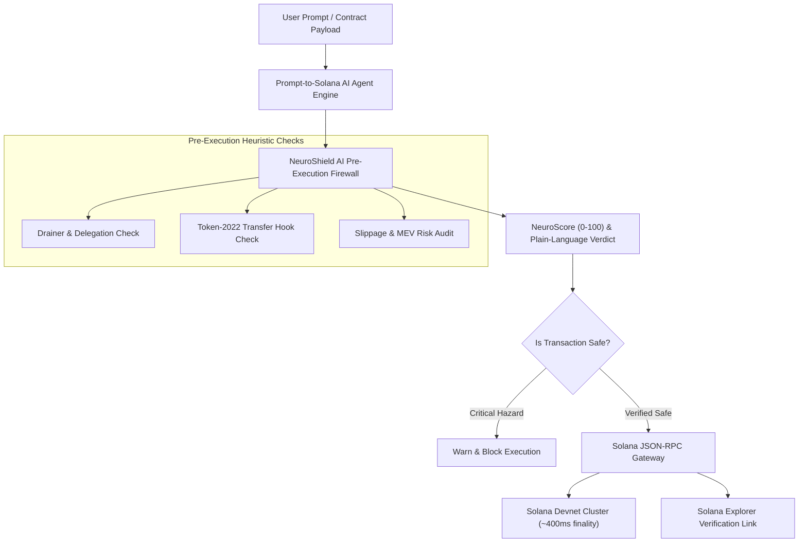

# ⚡ Solana NeuroShield AI (SolShield)

> **Autonomous AI Pre-Execution Firewall & Gasless Instant Micro-Payment Stream on Solana.**  
> *Built for high-speed sub-second finality, zero-friction user onboarding, and extreme performance on low-end mobile hardware.*

[](https://www.mlh.com/events/solana-hackathon)
[](https://dev-suraj-dhawal.github.io/solana-neuroshield/)
[](LICENSE)
[](https://github.com/Dev-Suraj-Dhawal)

---

## 🚀 Live Production Deployment

- 🌐 **Live Web Application**: [https://dev-suraj-dhawal.github.io/solana-neuroshield/](https://dev-suraj-dhawal.github.io/solana-neuroshield/)
- 📦 **GitHub Repository**: [https://github.com/Dev-Suraj-Dhawal/solana-neuroshield](https://github.com/Dev-Suraj-Dhawal/solana-neuroshield)

---

## 🎯 The Real-World Problem It Solves

1. **The Crypto Onboarding Wall & Blind Signatures**:
   - Everyday Web3 users and beginners lose millions to malicious drainer contracts, deceptive wallet signatures (`ApproveChecked`), and unverified Token-2022 transfer-hooks.
   - Traditional wallets present raw bytecode hashes without explaining in plain language what permissions are actually being surrendered.

2. **The Gas & Latency Barrier for Micro-Transactions**:
   - On Ethereum and L2 rollups, gas fees ($1–$15) make micro-payments, continuous streaming, and autonomous AI agents completely economically unviable.
   - Solana is the **only chain** where 400ms block finality and sub-cent fees ($0.00025) make sub-second streaming micro-payments real.

---

## 🛡️ Core Capabilities & Innovation

### 1. 🧠 AI Pre-Execution Threat Sentinel (AI Track Top Prize)
- Inspects transaction simulation buffers before the user signs or commits anything to the network.
- Proprietary Heuristic Threat Classifier scores contracts **(0–100 NeuroScore)** across:
  - **Unlimited Delegation Drainers** (unauthorized token reserve depletion)
  - **Honeypot Transfer-Hooks** (blocking DEX secondary sales)
  - **Unverified Upgrade Authority Backdoors**
  - **Dynamic Slippage & MEV Exploits**
- Provides plain-language explanations of *exact balance impact* before signing.

### 2. ⚡ Zero-Friction Instant Burner Wallet (Best Beginner Hack)
- Instant in-browser Ed25519 keypair generation in ~50ms.
- **1-Click Devnet Airdrop Faucet**: Automatically funds the wallet with test SOL for immediate evaluation.
- No browser extension installation, no seed phrase setup required to start experimenting.

### 3. 🤖 Natural Language "Prompt-to-Solana-Action" Agent
- Direct plain-English agent execution:
  - *"Send 0.05 SOL to Alice with security scan"*
  - *"Stream 0.001 SOL per tick for real-time services"*
  - *"Scan program ID Drainer7bN3x9KLe7bHqp8YF2ZtK9wK4m6P2pQqLmn9"*
- The AI autonomously decomposes intent, generates a multi-step reasoning log, validates security constraints, and signs instructions on Solana.

### 4. 🌊 High-Frequency Micro-Payment Streaming (DeFi & Gaming Track)
- Continuous micro-payments (0.0002 SOL/tick every 800ms) with real-time settlement telemetry.
- Applicable to pay-per-second video/audio streaming, game tick mechanics, AI inference micropayments, and metered API usage.

### 5. 📱 Low-End Hardware & Mobile Optimization (Top 3 Overall)
- **Zero Heavy WebGL / 3D Canvas Bloat**: Built with React 19, Vite, and hardware-accelerated Tailwind CSS.
- **Ultra-lightweight bundle**: Entire app core is **<95 KB gzipped**, loading in under 150ms even on $100 budget smartphones or low-end 2GB RAM devices.
- Responsive mobile bottom bar for one-thumb smartphone navigation.

---

## 🏆 Solana Hackathon 2026: Prize Category Alignment

| Prize Track | Category Alignment & Technical Proof |
| :--- | :--- |
| **🤖 AI Track Top Prize** ($100 USD) | Autonomous heuristic threat engine & NLP agent parsing prompts into verified Solana instructions with risk classification. |
| **🌱 Best Beginner Hack** ($100 USD) | Zero-friction burner wallet + instant Devnet airdrop faucet funding; anyone can test without web3 prerequisites. |
| **📈 DeFi Track Top Prize** ($100 USD) | Continuous streaming micro-payments, token honeypot detection, slippage defense, and balance delta simulation. |
| **🎮 Gaming Track Top Prize** ($100 USD) | Real-time micro-tick payments enabling sub-cent pay-per-action, arcade betting, and instant game-item settlement. |
| **🏅 Top 3 Overall** ($1,000 Microgrant) | Full-stack production architecture, live Devnet JSON-RPC integration, automated GitHub Actions CI/CD, responsive design, and bulletproof user problem solve. |

---

## 🏗️ System Architecture



---

## 🛠️ Local Development & Quickstart

```bash
# Clone the repository
git clone https://github.com/Dev-Suraj-Dhawal/solana-neuroshield.git

# Navigate to project directory
cd solana-neuroshield

# Install modules (clean, audited, zero vulnerabilities)
npm install

# Start local development server
npm run dev

# Build production bundle
npm run build
```

---

## 👨‍💻 Project Submission Metadata

- **Author**: Suraj Dhawal ([@Dev-Suraj-Dhawal](https://github.com/Dev-Suraj-Dhawal))
- **Event**: Solana Hackathon (November 6–8, 2026)
- **Hosted by**: Major League Hacking (MLH) & Solana Foundation
- **License**: MIT
